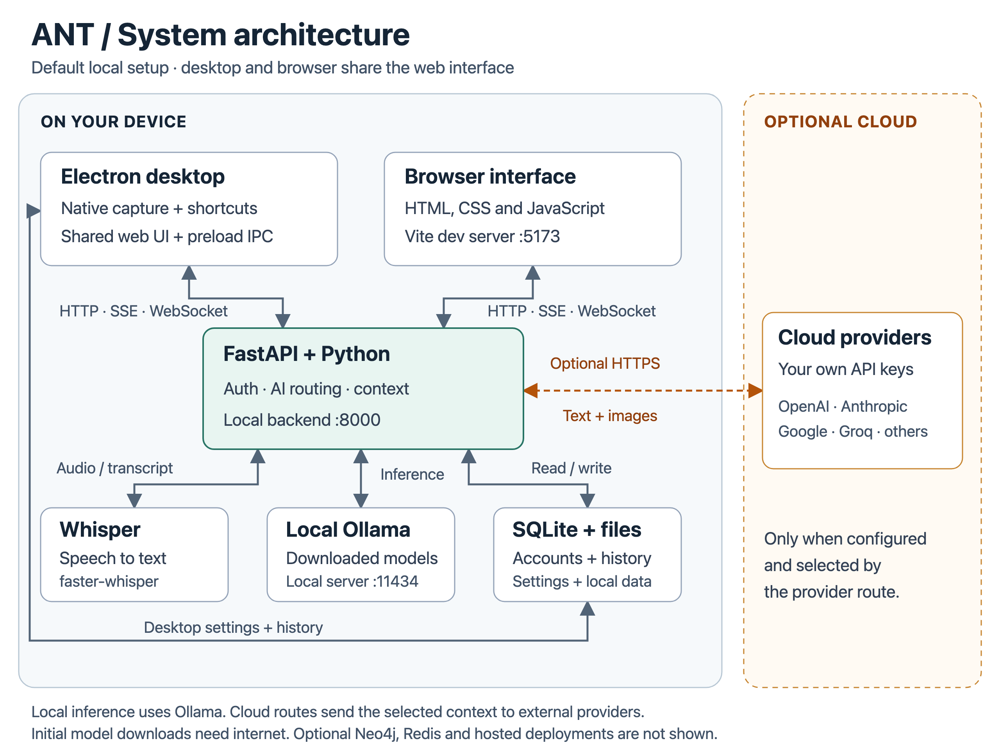

# ANT · AI Note Taker

A desktop application for voice notes, screen-aware questions, and interview preparation. ANT combines a floating Electron interface with a local Python backend. Use local Whisper transcription and Ollama models, connect a supported account, or bring your own cloud AI keys.

[](https://github.com/shyamsunderprogramer-design/ai-note-taker/releases/latest)
[](https://github.com/shyamsunderprogramer-design/ai-note-taker/actions/workflows/ci.yml)
[](LICENSE)

**[Download](#download) · [Source setup](#run-from-source) · [Privacy](#privacy-and-data) · [Build guide](docs/PROJECT-BUILD-GUIDE.md) · [Troubleshooting](#troubleshooting) · [Documentation](#documentation)**

The desktop interface is bundled in `electron/renderer`. This repository has no standalone website or PWA build. Mobile and extension projects are optional companions.

Already installed the source dependencies? From the repository root, run:

```bash
npm run electron:start
```

For a fresh checkout, follow [Run from source](#run-from-source). The [end-to-end project build guide](docs/PROJECT-BUILD-GUIDE.md) covers architecture, configuration, storage, testing, packaging and releases.

## Source status and verified behavior

The November 12, 2026 checks cover the working source; they do not establish that these changes are included in a downloaded installer.

| Area | Implemented behavior and evidence |
| --- | --- |
| Typed questions | Standalone text questions skip unnecessary screen capture and OCR. Explicit screen requests and attachments retain their context. |
| Screen questions | The renderer limits its OCR wait to 2.5 seconds, retaining the image for a compatible vision model if OCR is unavailable or slow. |
| Answer display | Enter submission and numeric-answer rendering have regression coverage; streamed responses update the conversation as text arrives. |
| Capture protection | Protected dropdowns and tooltips stay inside the app window. Synthetic-window checks passed region screenshots, ScreenCaptureKit window/display screenshots and 18 recording frames on the tested Mac. |
| Regression checks | 260 desktop tests and 29 renderer tests passed; 84 asset references resolved and 20 scripts passed syntax checks. These are dated results, not a fresh test run for each checkout. |

Measured typed-question preparation was **78 ms** after the change. A separate real ChatGPT request produced its first text in **2.6 seconds**. Preparation time is not total answer time; provider availability, model load, network and context still affect latency. See the [latency report](docs/qa/reports/DESKTOP-FINAL-2026-11-12.md) and [capture matrix and limitations](docs/qa/reports/CAPTURE-MATRIX-2026-11-12.md).

## Download

The links below target **[ANT v2.3.0-rc.2](https://github.com/shyamsunderprogramer-design/ai-note-taker/releases/tag/v2.3.0-rc.2)**, a release candidate for testing. Its release notes cover remembered logins, microphone recordings and optional screen-capture failures. Read the [release notes and known limits](docs/releases/2.3.0-rc.2.md) before upgrading, or check [all releases](https://github.com/shyamsunderprogramer-design/ai-note-taker/releases) for available versions. Later source changes require running the updated checkout or building a new package.

The desktop packages include Electron and a standalone Python runtime. Mac downloads also include the screen-capture helper; Xcode is not required. You do **not** need to install Python or Node.js to use them. AI model downloads, Ollama for local AI, and cloud provider credentials are separate.

| Platform | Installer | Notes |
|---|---|---|
| **Windows 10/11 (x64)** | [Windows installer (.exe)](https://github.com/shyamsunderprogramer-design/ai-note-taker/releases/download/v2.3.0-rc.2/ANT-Setup-2.3.0-rc.2-win-x64.exe) | Install ANT with the setup wizard. |
| **Windows 10/11 (x64), portable** | [Portable Windows app (.exe)](https://github.com/shyamsunderprogramer-design/ai-note-taker/releases/download/v2.3.0-rc.2/ANT-2.3.0-rc.2-win-x64.exe) | Run without the setup wizard. |
| **macOS (Apple Silicon)** | [Apple Silicon Mac (.zip)](https://github.com/shyamsunderprogramer-design/ai-note-taker/releases/download/v2.3.0-rc.2/ANT-2.3.0-rc.2-mac-arm64.zip) | macOS 14 or newer; extract and move the app to Applications. |
| **macOS (Intel)** | [Intel Mac (.zip)](https://github.com/shyamsunderprogramer-design/ai-note-taker/releases/download/v2.3.0-rc.2/ANT-2.3.0-rc.2-mac-x64.zip) | macOS 14 or newer; extract and move the app to Applications. |
| **Linux (x64)** | [Linux AppImage](https://github.com/shyamsunderprogramer-design/ai-note-taker/releases/download/v2.3.0-rc.2/ANT-2.3.0-rc.2-linux-x86_64.AppImage) | Make the downloaded file executable, then run it. |
| **Linux (Debian/Ubuntu, x64)** | [Debian package (.deb)](https://github.com/shyamsunderprogramer-design/ai-note-taker/releases/download/v2.3.0-rc.2/ANT-2.3.0-rc.2-linux-amd64.deb) | Install with your package manager. |

**Verify the file:** compare `shasum -a 256 <downloaded-file>` on macOS/Linux, or `certutil -hashfile <downloaded-file> SHA256` on Windows, with the matching entry in [SHA256SUMS.txt](https://github.com/shyamsunderprogramer-design/ai-note-taker/releases/download/v2.3.0-rc.2/SHA256SUMS.txt).

### First launch

Quit ANT before replacing the app. Sign in once after upgrading and check **Remember me** if you want the login restored after quitting. Microphone and screen recording still need permission in macOS **System Settings → Privacy & Security**.

Back up existing data: this candidate does not automatically migrate data out of an older installation's internal resources. Windows builds have no publisher certificate and may display a publisher warning. On Linux, make the AppImage executable or install the `.deb` with your package manager.

**macOS verification warning:** these builds are signed ad hoc, without an Apple Developer ID certificate or notarization. A message such as “Apple could not verify ANT” means macOS cannot verify the app through its normal trust checks; it is not a safety assessment of this release.

If you trust the official download and its checksum matches:

1. Extract the ZIP for your Mac's processor and move **ANT (AI Note Taker).app** to **Applications**.
2. Try opening it once, then dismiss the verification warning.
3. Open **System Settings → Privacy & Security**, scroll to **Security**, and select **Open Anyway** for ANT.
4. Confirm **Open** and authenticate if requested.

This creates an exception for ANT. See [Apple's instructions](https://support.apple.com/en-us/102445). If the alert instead says the app will damage your computer or is damaged, stop and investigate that different warning.

## Features

| Workflow | What ANT provides |
| --- | --- |
| Voice notes and live assistance | Local speech transcription, live transcript display, microphone input, and system-audio capture where supported. |
| AI conversations | Streamed answers, follow-up context, model selection, and local or cloud providers. Auto/race routing can contact multiple enabled providers. |
| Screen questions | Attach screenshots or enable automatic capture; image questions require a vision-capable model. |
| Meeting notes and history | Conversation history, summaries, search, and export controls. |
| Interview preparation | Resume and job-description context, practice interviews, and preparation pages. |
| Desktop controls | Floating window, global shortcuts, tray controls, and OS-dependent capture protection. |

Mobile apps and browser extensions are separate projects in this repository; the desktop release does not certify all of their workflows. Legacy CRM write integrations remain unavailable until real provider implementations are connected.

## Architecture

[](docs/architecture/overview.svg)

The diagram is a historical overview of the local setup. Electron starts the Python backend on `127.0.0.1:8000`. The interfaces use HTTP, streamed responses and WebSocket audio. Desktop native features use Electron's preload IPC bridge. Connected-account answers can also route through the Electron main process directly; the [current execution flows](docs/PROJECT-BUILD-GUIDE.md#2-architecture-and-execution-flows) describe both paths.

Whisper turns audio into text. The AI router sends the selected conversation and image context to local Ollama or configured cloud providers. SQLite and local files store application data; Electron also saves its own conversation JSON and settings. A remotely hosted backend moves the corresponding processing and data to that server.

[Architecture guide and source map](docs/architecture/README.md) · [Editable SVG](docs/architecture/overview.svg)

The product is a desktop application. Its bundled interface lives in `electron/renderer`; there is no standalone website or PWA build.

## Run from source

Use this path for development or to run the source directly. Packaged-app users can skip to [Start using ANT](#start-using-ant).

### 1. Prerequisites

- Git.
- **Python 3.12**, with `3.12.15` pinned in [`.python-version`](.python-version).
- **Node.js 22.12.0 or newer** and **npm 10 or newer**, as declared in [`package.json`](package.json).
- macOS 14 or newer, Windows 10/11 x64, or Linux x64 for the desktop targets covered by the release workflow.
- Xcode Command Line Tools on macOS for native source helpers and packaging. Mac system-audio capture requires macOS 14.2 or newer.
- [Ollama](https://ollama.com/download) if you want local AI. Cloud AI does not require a local Ollama server.

Initial package installation and model downloads require internet access. Model size and available memory affect local performance. PostgreSQL, Redis and Neo4j are optional for the basic local workflow.

### 2. Clone and install

```bash
git clone https://github.com/shyamsunderprogramer-design/ai-note-taker.git
cd ai-note-taker
```

**macOS / Linux**

```bash
python3.12 -m venv AINT_Venv
source AINT_Venv/bin/activate
python -m pip install --upgrade pip
python -m pip install -r backend/requirements.txt
npm ci
```

**Windows PowerShell**

```powershell
py -3.12 -m venv AINT_Venv
.\AINT_Venv\Scripts\python.exe -m pip install --upgrade pip
.\AINT_Venv\Scripts\python.exe -m pip install -r backend/requirements.txt
npm ci
```

Keep the virtual environment named `AINT_Venv`: the desktop launcher looks there before falling back to a system Python. Run `npm ci` at the repository root so it installs the locked workspace dependencies.

### 3. Configure the backend

Copy the template to a private `.env` file:

```bash
test -f .env || cp .env.example .env
```

In PowerShell, use `if (!(Test-Path .env)) { Copy-Item .env.example .env }`. On an existing checkout, check for `backend/.env`: dotenv finds it before the repository-root `.env`.

For a separately launched backend, generate a stable JWT signing secret:

```bash
python -c "import secrets; print(secrets.token_urlsafe(64))"
```

In PowerShell, replace `python` with `.\AINT_Venv\Scripts\python.exe`. Put the output in the standalone backend's `JWT_SECRET_KEY`; keep it private and stable across restarts. Electron-managed launches supply a persisted signing secret unless the parent process exports an override. The backend encryption manager uses a key file (`ANT_ENCRYPTION_KEY_FILE` or its default), not the historical `ENCRYPTION_KEY` template setting. See the [configuration and storage reference](docs/PROJECT-BUILD-GUIDE.md#5-configuration-reference). Do not commit secrets or `.env`.

For local desktop development, keep authentication enabled and use loopback HTTP:

```dotenv
ENVIRONMENT=development
AUTH_REQUIRED=true
HTTPS_REQUIRED=false
CORS_ORIGINS=http://localhost:8000,http://127.0.0.1:8000
```

The default local database is SQLite. Additional deployment settings are described in [`.env.example`](.env.example).

### 4. Choose local or cloud AI

**Local:** install Ollama and start its service. The repository's general-purpose default is [qwen3.5:9b](https://ollama.com/library/qwen3.5:9b):

```bash
ollama pull qwen3.5:9b
ollama list
```

If needed, run `ollama serve` in a separate terminal. Select an installed model in ANT. To use another model, update `OLLAMA_MODEL` and any relevant `OLLAMA_MODEL_*` overrides in `.env`; you do not need every model listed in the template.

**Subscription login (source build):** open **Settings → Providers** in the desktop app. Connect ChatGPT or the account signed into your local Ollama app, then select a model for answers. No manual API key is needed for these connections. Enable cross-account fallback and/or an installed local model to keep answering after a 429 usage limit. Claude, Gemini, Grok and Groq retain their API-key connections; their consumer logins are not integrated. See [subscription setup and limits](docs/SUBSCRIPTIONS.md). Restart with `npm run electron:start` after updating the source; existing downloaded releases do not contain this feature yet.

**Cloud:** choose **API key** beside a provider in **Settings → Providers**. The desktop saves keys locally in encrypted storage and offers a `.env` copy in its private app-data folder; uncheck that option for encrypted storage only. You can also configure a standalone backend through its own `.env`. Then select that provider/model. Cloud requests require internet access and provider quota. Usage is billed through your provider account.

Screenshot questions require a model that accepts images. Text-only models can answer typed or transcribed questions.

### 5. Launch

**Desktop**, from the repository root:

```bash
npm run electron:start
```

Electron starts the local backend automatically, or reuses a responding backend on port 8000.

The local backend exposes API documentation at **http://127.0.0.1:8000/docs** and health at **http://127.0.0.1:8000/health**.

## Start using ANT

1. Create an account or sign in, then complete onboarding.
2. Choose a provider and model. Send a typed question first to check the connection.
3. Allow microphone access for voice input. The first transcription may download a speech model.
4. For screen questions, grant the required recording permission and select a vision-capable model.
5. Use History to revisit conversations, or generate a meeting summary and export it.

Microphone input captures your voice. System-audio capture, where available, captures sound played by the computer and needs the appropriate OS permissions. Screen capture protection and screenshot capture are separate controls.

### Desktop shortcuts

Use **Cmd** on macOS and **Ctrl** on Windows/Linux for `Ctrl / Cmd` entries.

| Shortcut | Action |
| --- | --- |
| `Ctrl / Cmd + Enter` | Trigger an AI response globally. |
| `Ctrl / Cmd + Shift + Enter` | Trigger an answer with screen context. |
| `Ctrl / Cmd + ,` | Open Settings. |
| `Alt + Space` | Hide or show the window. |
| `Alt + D` | Toggle capture-protection mode. |
| `Ctrl / Cmd + Arrow keys` | Move the window. |

The OS or another application may already use a global shortcut. Check the desktop logs if registration fails.

## Privacy and data

- **Transcription:** with the backend running locally, Whisper processes audio on your machine. Model downloads still require a network connection initially.
- **Local AI:** a local Ollama model processes the selected prompt on your machine. Remote Ollama endpoints and cloud models send it to their configured server.
- **Cloud AI:** selected transcript, conversation, resume and image context can be sent to the configured provider. Auto/race routing can send a request to more than one enabled provider.
- **Storage:** desktop history and settings are local. Packaged backend data is written to a user-data directory; source installs use local development paths. The bundled renderer also uses browser storage. Local storage does not mean every file is encrypted. Back up data and protect credentials before moving or replacing an installation; see the [storage and backup reference](docs/PROJECT-BUILD-GUIDE.md#7-storage-authentication-and-backups).
- **Credentials:** supported desktop credential stores use OS-backed encryption. The optional provider `.env` copy is plaintext in the private app-data folder; disable that copy if you want encrypted credential storage only.

If you connect the interface to a remote backend, the audio, uploads and application data handled by that backend are processed on the remote server.

### Capture protection and stealth

Enable capture protection through the desktop controls or `Alt + D`. The implementation applies protection to registered app windows and reapplies it through window lifecycle changes. Dropdowns and tooltips render inside the protected window so they do not become separate native popups. Scrolling does not create a separate protection boundary.

**Universal screenshot invisibility is not guaranteed.** Support depends on the operating system and capture method; Linux capture protection is unsupported. The [November 12 capture matrix](docs/qa/reports/CAPTURE-MATRIX-2026-11-12.md) records successful synthetic-fixture tests on macOS 27.2 with Electron 41.10.7, including region screenshots, full-display capture and a bounded recording. It does not certify every application page, recorder, OS version or remote desktop.

Electron documents a macOS ScreenCaptureKit limitation; the source reference is linked from the [capture report](docs/qa/reports/DESKTOP-FINAL-2026-11-12.md#capture-protection). A successful protection flag or one screenshot test does not prove every capture path is blocked. ANT's own screenshot capture for AI context is a separate feature from protection against external capture.

## Development and testing

Run these from the repository root after installing dependencies:

| Command | Purpose |
| --- | --- |
| `npm run renderer:check` | Validate the bundled desktop interface. |
| `npm run electron:start` | Launch the desktop app. |
| `npm test` | Run desktop and renderer unit tests. |
| `npm --workspace ai-note-taker test` | Run Electron unit tests. |
| `npm --workspace ant-desktop-renderer test` | Run desktop renderer unit tests. |
| `npm run mobile:test -- --runInBand` | Run mobile Jest tests. |
| `npm run test:security` | Run dependency/security regression tests. |
| `npm run e2e:install:browsers` | Install the Playwright browsers. |
| `npm run e2e:test` | Run the browser suite with isolated test servers. |
| `make help` | List the Make convenience targets. |

For backend tests on macOS/Linux, use the isolated runner from the repository root to keep test data separate from normal development data:

```bash
AINT_Venv/bin/python -m pip install -r backend/requirements-test.txt
AINT_Venv/bin/python qa/performance/backend/isolated.py test
```

See the [testing guide](docs/PROJECT-BUILD-GUIDE.md#9-how-to-test-the-application) for backend setup, isolated renderer tests and live capture verification. [CI](.github/workflows/ci.yml) runs backend, desktop, renderer and mobile checks, browser tests of the bundled interface, workflow validation and security checks. [CodeQL](.github/workflows/codeql.yml) runs separately. Passing checks do not establish that every optional integration or target-device audio workflow has been tested; see the [release limits](docs/releases/2.3.0-rc.2.md).

### Build a desktop package

Build on the target OS and architecture. With Python 3.12 available as `python`, prepare the standalone runtime from the repository root:

```bash
npm ci
npm run renderer:check
python scripts/build_desktop_runtime.py
```

Then enter `electron/` and choose the command matching your build host:

| Host | Command |
| --- | --- |
| Apple Silicon Mac | `npx electron-builder --mac --arm64 --publish never` |
| Intel Mac | `npx electron-builder --mac --x64 --publish never` |
| Windows x64 | `npx electron-builder --win --x64 --publish never` |
| Linux x64 | `npx electron-builder --linux --x64 --publish never` |

Output goes to `electron/dist/`. The runtime builder downloads the checksum-pinned Python defined in [`scripts/python-runtime.json`](scripts/python-runtime.json), installs the backend dependencies into `AINT_Python/`, and refuses to overwrite an existing runtime directory. `AINT_Venv` is the development environment; `AINT_Python` is the packaged runtime. The generic `npm run build` requests all desktop platforms, so use an explicit native target for a single-platform package.

From the repository root, verify a completed package with `python scripts/verify_desktop_package.py`. See the [packaging guide](docs/PROJECT-BUILD-GUIDE.md#10-how-to-build-desktop-packages) for resource selection, signing limitations and acceptance checks. Installer builds were not rerun for this README update.

The [release workflow](.github/workflows/release.yml) is the reference for the four native build targets, bundled-runtime audits, packaged sign-in checks and checksums. macOS output is ZIP; Windows output is installer and portable EXE; Linux output is AppImage and DEB.

## Project layout

```text
electron/                    Desktop main process, preload, capture and packaging
electron/renderer/           Bundled desktop interface
apps/ant-chrome-extension/    Browser extension workspace
backend/core/                FastAPI entry point, configuration and database
backend/routes/              API route modules
backend/modules/             AI, voice, interview and other services
mobile/                      React Native app
e2e/                         Playwright browser tests
scripts/                     Runtime preparation and release verification
docs/                        Setup, architecture, API and operations guides
```

Additional extension variants and deployment templates are included in the repository. Consult their own documentation before using them.

## Troubleshooting

| Problem | What to check |
| --- | --- |
| macOS says Apple could not verify ANT | Follow the [first-launch steps](#first-launch) for the official download. This release has no Apple notarization. |
| Backend is offline | Confirm dependencies are in `AINT_Venv`; run the backend manually to see startup errors. Packaged builds require their bundled Python directory. |
| Port 8000 is occupied | Check whether ANT is already running before starting another backend. |
| Desktop cannot connect to the backend | Check `http://127.0.0.1:8000/health` and the effective backend environment. There is no separate port 5173 desktop server. |
| Local model is unavailable | Check `ollama list`, the running service, model selection and per-mode overrides. |
| Cloud request fails | Check the provider key, model access, enabled providers and available quota. |
| Audio or screenshots are missing | Check the selected device and OS recording permissions; system-audio support varies by platform. |
| First transcription is slow | Allow the speech model download and initial load to finish. |
| Typed answers are slow | Check the selected provider, quota and model load. Separate preparation time from time to first provider text; see the [latency report](docs/qa/reports/DESKTOP-FINAL-2026-11-12.md). |
| Connected account returns HTTP 429 | Wait for account availability or explicitly select a configured alternative. Reinstalling does not remove the provider's usage limit. |
| Dropdown or tooltip appears in a screenshot | Run the updated source, confirm protection is enabled and test the actual capture tool. See the [capture matrix](docs/qa/reports/CAPTURE-MATRIX-2026-11-12.md); protection is not universal. |
| Sign-in fails after restart | Electron persists its backend signing secret. For a standalone backend, keep `JWT_SECRET_KEY` stable. Check the active data directory and environment, then sign in again after correcting them. |

See the [troubleshooting guide](docs/devops/development/TROUBLESHOOTING.md) for more detail.

## Documentation

**[End-to-end project build guide](docs/PROJECT-BUILD-GUIDE.md)** — source setup, architecture, subsystem map, configuration, storage, testing, native packaging, releases, troubleshooting, and a dated validation ledger.

- [Documentation index](docs/README.md)
- [Files by role](docs/ROLES.md)
- [Architecture diagram and source map](docs/architecture/README.md)
- [v2.3.0-rc.2 release notes](docs/releases/2.3.0-rc.2.md) and [changelog](CHANGELOG.md)
- [Desktop latency verification](docs/qa/reports/DESKTOP-FINAL-2026-11-12.md) and [capture-protection matrix](docs/qa/reports/CAPTURE-MATRIX-2026-11-12.md)
- [Detailed installation](docs/devops/development/INSTALL.md)
- [Environment template](.env.example)
- [Cognitive Graph setup](docs/backend/setup/SETUP_COGNITIVE_GRAPH.md)
- [Mobile](mobile/README.md), [browser extension](apps/ant-chrome-extension/README.md), and [Docker](docker/README.md)
- [Contributing](CONTRIBUTING.md) and [security policy](SECURITY.md)

## License

[MIT](LICENSE).
