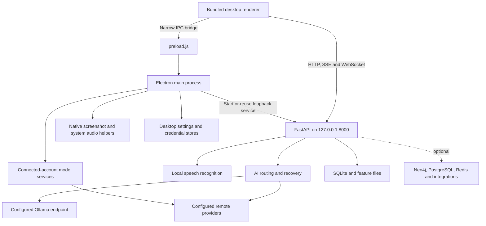

# ANT: end-to-end project build guide

Reviewed against the local source tree on **13 November 2026**. Application version: **2.3.0-rc.2**. This guide describes the working tree, including desktop changes that may not be present in a downloaded release. It is not a certification that every integration or installer has been tested.

ANT is an Electron desktop application with a bundled HTML/CSS/JavaScript interface, a local Python/FastAPI backend, native capture helpers, and optional AI providers. The interface uses browser technology **inside the desktop app**. There is no separate website, Vite development server, PWA, or `apps/web` build in the current desktop workflow.

Use this document to set up a development machine, understand the application, change it, test it, build distributable packages, and prepare a release. Executable configuration takes precedence over historical documentation: [root package](../package.json), [desktop package](../electron/package.json), [runtime builder](../scripts/build_desktop_runtime.py), and [release workflow](../.github/workflows/release.yml).

## Contents

1. [Product scope and repository map](#1-product-scope-and-repository-map)
2. [Architecture and execution flows](#2-architecture-and-execution-flows)
3. [Prerequisites](#3-prerequisites)
4. [Tutorial: run the desktop app from source](#4-tutorial-run-the-desktop-app-from-source)
5. [Configuration reference](#5-configuration-reference)
6. [Subsystem reference](#6-subsystem-reference)
7. [Storage, authentication, and backups](#7-storage-authentication-and-backups)
8. [How to develop a feature](#8-how-to-develop-a-feature)
9. [How to test the application](#9-how-to-test-the-application)
10. [How to build desktop packages](#10-how-to-build-desktop-packages)
11. [How to prepare and release a version](#11-how-to-prepare-and-release-a-version)
12. [Optional clients and server infrastructure](#12-optional-clients-and-server-infrastructure)
13. [Troubleshooting](#13-troubleshooting)
14. [Capabilities and remaining limitations](#14-capabilities-and-remaining-limitations)
15. [Source review and validation ledger](#15-source-review-and-validation-ledger)
16. [Maintenance checklist](#16-maintenance-checklist)

## 1. Product scope and repository map

The core product covers typed and spoken questions, streamed AI answers, screen context, live assistance, conversation history, interview preparation, and desktop window controls. Optional services expand this with knowledge graphs, semantic search, meeting agents, and integrations.

| Location | Responsibility | Needed for the basic desktop app? |
| --- | --- | --- |
| [`electron/main.js`](../electron/main.js) | Desktop lifecycle, windows, IPC handlers, backend launch, shortcuts, settings, provider bridge | Yes |
| [`electron/preload.js`](../electron/preload.js) | Restricted renderer-to-main bridge and protected in-document controls | Yes |
| [`electron/stealth.js`](../electron/stealth.js) | OS capture-protection requests and window lifecycle enforcement | Yes |
| [`electron/renderer/`](../electron/renderer/) | Bundled UI, sign-in, settings, chat, secondary pages and overlays | Yes |
| [`electron/lib/`](../electron/lib/) | Paths, credentials, subscriptions, capture, audio, logging, privacy, runtime selection | Yes |
| [`electron/features/`](../electron/features/) | Overlay adapter and recording features | Feature-dependent |
| [`backend/core/`](../backend/core/) | FastAPI application, configuration, database, startup support | Yes |
| [`backend/routes/`](../backend/routes/) | HTTP and WebSocket contracts grouped by feature | Yes |
| [`backend/lib/`](../backend/lib/) | Shared streaming, storage, provider, audio, grounding, OCR and recovery helpers | Yes |
| [`backend/security/`](../backend/security/) | Authentication, authorization support, validation, encryption, audit and rate limits | Yes |
| [`backend/modules/`](../backend/modules/) | AI, voice, interview, agent, CRM, platform and video implementations | Core plus optional features |
| [`backend/migrations/`](../backend/migrations/) | Alembic schema history | Yes for schema maintenance |
| [`scripts/`](../scripts/) | Standalone Python runtime, package verification, release checksums, renderer checks | Build/test tools |
| [`qa/`](../qa/) and [`e2e/`](../e2e/) | Security, performance, live desktop and isolated renderer checks | Validation |
| [`mobile/`](../mobile/) | Separate React Native client | No |
| [`apps/ant-chrome-extension/`](../apps/ant-chrome-extension/) | Workspace-managed browser extension | No |
| [`browser-extension/`](../browser-extension/), [`chrome-extension/`](../chrome-extension/), [`vscode-extension/`](../vscode-extension/) | Other extension code; verify which implementation a workflow uses | No |
| [`docker/`](../docker/), [`k8s/`](../k8s/), [`infrastructure/`](../infrastructure/) | Optional server/container/cloud deployment material | No |
| [`vendor/`](../vendor/) | Local dependency compatibility packages referenced by npm overrides | Yes for a reproducible root install |
| [`assets/design/`](../assets/design/) | Design source material and prototypes | No |
| [`docs/`](./), [`agents/`](../agents/) | Project documentation and ownership guidance | Contributor reference |

Do not delete `electron/renderer` because it contains HTML or JavaScript. It is the desktop interface and is copied into installed packages. QA may temporarily serve that interface over loopback HTTP to test it; that does not create a deployable web product.

## 2. Architecture and execution flows

### Process and trust boundaries



The connected-account route is important: not every answer goes through the Python AI router. [Subscription IPC](../electron/lib/subscriptions.js) and [connected-model routing](../electron/lib/connected-models.js) can send an answer request from Electron's main process. OAuth tokens stay out of the renderer.

### Startup

1. `npm run electron:start` selects the `ai-note-taker` workspace and runs `electron .` from its package directory.
2. The main process establishes app-data paths, runtime privacy settings, provider/auth services, and the saved capture-protection intent. Newly created windows register with the protection module.
3. The bundled renderer loads. Source mode resolves Python from `AINT_Venv`; packaged mode requires `resources/python`.
4. Electron checks the local backend and otherwise launches Uvicorn on **127.0.0.1:8000**, with the correct Python import path, authentication enabled, and a stable signing secret.
5. FastAPI mounts routers, initializes its database/migrations and available services, and reports health. Optional service warnings do not by themselves mean the desktop failed to start.
6. Sign-in/onboarding and provider configuration determine which features can operate.

See [main process](../electron/main.js), [Python resolution](../electron/lib/python-runtime.js), [paths](../electron/lib/paths.js), and [FastAPI entry point](../backend/core/main.py). Launch the **package directory**, not `electron/main.js` directly: the latter can select a different Electron profile and make settings/authentication appear missing.

### Typed question

`submitText` creates a question ticket, checks a selected subscription connection, prepares eligible models, and determines whether screen context is needed. A standalone question can proceed without OCR. Explicit screen requests, attachments and supplied context keep their screen information. The renderer then sends the prompt, applicable history and configured context through the selected route and renders streamed text.

Ticket/cancellation checks prevent stale answers from replacing a newer request. Duplicate submissions are suppressed. Numeric answers such as `4.` remain paragraphs instead of becoming empty numbered lists. First text is brought into view unless the reader has deliberately scrolled away.

Sources: [renderer controller](../electron/renderer/app.js), [session context](../electron/renderer/js/unified-session.js), [recovery route](../backend/routes/recovery.py), [answer-format tests](../electron/tests/answer-format.test.js).

### Screen question

The main process captures external screen content. On macOS, the native capture helper excludes ANT from **ANT's own context capture**; that exclusion is separate from preventing other applications from capturing ANT. The image is offered to local OCR. Native Apple Vision is preferred, with existing Ollama/Tesseract fallbacks when unavailable.

The renderer waits up to **2.5 seconds** for its OCR fetch. If recognition is unavailable or too slow, it retains the image for the existing vision route. This requires an eligible image-capable model. Aborting the client wait does not terminate a backend OCR worker already in progress. Screen text is treated as reference material, not trusted instructions.

Sources: [capture coordination](../electron/lib/screen-context.js), [native capture](../electron/lib/screen-capture.swift), [OCR service](../backend/modules/ai/ocr_service.py), [native OCR](../backend/lib/native_ocr.py), [screen-context tests](../electron/tests/question-screen-context.test.js).

### Speech and live assistance

Microphone input and supported system audio feed the transcription paths. Live WebSocket updates distinguish provisional speech from finalized utterances. The session controller retains relevant observations and deduplicates overlapping microphone/system questions before requesting assistance. Silence, missing permission, ASR warm-up, model inference and answer generation are separate sources of delay.

The macOS system-audio implementation uses `audiotee` and reports silence explicitly. The optional Apple Silicon speech path uses cached MLX Whisper weights; base speech recognition uses faster-whisper. Installing optional acceleration is a separate action from downloading its model weights.

Sources: [system audio](../electron/lib/system-audio.js), [session controller](../electron/renderer/js/unified-session-controller.js), [transcription routes](../backend/routes/transcription.py), [Whisper handler](../backend/modules/voice/whisper_handler.py), [Apple speech acceleration](../backend/modules/voice/apple_speech.py).

## 3. Prerequisites

| Component | Requirement in this checkout | Purpose |
| --- | --- | --- |
| Git | Working Git installation | Obtain source and tracked vendor packages |
| Node.js | `>=22.12.0`; CI uses the Node 22 line | npm workspaces, Electron and test tools |
| npm | `>=10.0.0` | Root lockfile installation |
| Python | Python 3.12; `.python-version` pins **3.12.15** | Backend development and build tooling |
| Electron | **41.10.7**, installed through the lockfile | Desktop runtime |
| electron-builder | **26.15.3** in desktop manifest | Distributable packages |
| macOS | Package minimum **14.0**; the system-audio tap helper requires the corresponding newer macOS audio APIs, described as 14.2+ in its source | Desktop/capture/audio capabilities differ |
| Windows/Linux | Configured release targets are x64; use the target OS for release builds | Native runtime and installer validation |
| Xcode Command Line Tools on macOS | `xcrun`, Swift compiler and signing tools available | Source screenshot helper and Mac packaging |
| Ollama | Optional, running separately if selected | Local models or the configured Ollama account route |
| Cloud account/API credentials | Optional, required for the selected remote route | Remote inference |

Sources: [root engines](../package.json), [Python pin](../.python-version), [desktop targets](../electron/package.json), [release matrix](../.github/workflows/release.yml).

Installed-app users do not need Node or Python: installers bundle them. The screen-capture helper is also prebuilt into Mac packages. Native OCR is a different helper: its Python wrapper currently compiles a Swift executable into a private cache when available, then falls back when it cannot. Do not assume every optional native feature has a bundled executable.

Initial npm/pip installation, runtime downloads and model downloads require network access. Hardware requirements depend strongly on selected speech and language models; no single RAM or latency requirement is established for every configuration. Neo4j, PostgreSQL, Redis, Docker and Kubernetes are not prerequisites for the basic local app.

## 4. Tutorial: run the desktop app from source

Run commands from the repository root unless a step explicitly changes directory. Keep existing credentials and user data; the configuration-copy step below avoids replacing an existing `.env`.

### Step 1: obtain the source and install dependencies

```bash
git clone https://github.com/shyamsunderprogramer-design/ai-note-taker.git
cd ai-note-taker
```

For an existing checkout, enter its directory instead. Worktree-only changes described here must also be present; cloning an older commit does not reconstruct uncommitted work.

On macOS/Linux:

```bash
python3.12 -m venv AINT_Venv
source AINT_Venv/bin/activate
python -m pip install --upgrade pip
python -m pip install -r backend/requirements.txt
npm ci
python -m pip check
```

On Windows PowerShell:

```powershell
py -3.12 -m venv AINT_Venv
.\AINT_Venv\Scripts\python.exe -m pip install --upgrade pip
.\AINT_Venv\Scripts\python.exe -m pip install -r backend/requirements.txt
npm ci
.\AINT_Venv\Scripts\python.exe -m pip check
```

Keep the name **AINT_Venv** because the desktop resolver searches it. Use root `npm ci`, not separate installs in every workspace; local `vendor/*.tgz` overrides and the root lockfile are part of the dependency graph. A successful `pip check` reports `No broken requirements found`.

For Mac source capture, check the compiler:

```bash
xcrun --find swiftc
```

If the command reports missing developer tools, install them with `xcode-select --install`, complete the installer, and check again. Do not run this Mac-specific command on Windows/Linux.

### Step 2: configure local operation and open ANT

On macOS/Linux:

```bash
test -f .env || cp .env.example .env
```

On Windows PowerShell:

```powershell
if (!(Test-Path .env)) { Copy-Item .env.example .env }
```

Edit the effective backend environment file and ensure these local settings:

```dotenv
ENVIRONMENT=development
CLOUD_MODE=false
AUTH_REQUIRED=true
HTTPS_REQUIRED=false
FORCE_SQLITE=true
```

An existing `backend/.env` is loaded before the repository-root `.env`; already-set process variables take precedence. See the [configuration reference](#5-configuration-reference) before debugging a setting that appears ignored. The template contains historical comments; the source determines actual behavior.

For an Electron-managed backend, the launcher supplies a stable JWT secret and forces authentication on. For a separately launched backend, generate a private signing secret and set `JWT_SECRET_KEY` in its effective environment:

```bash
python -c "import secrets; print(secrets.token_urlsafe(64))"
```

Use the Windows virtual-environment Python path if it is not activated. Never commit generated secrets. Do not regenerate a working secret on every launch.

Open the desktop app:

```bash
npm run electron:start
```

Expected result: a desktop window with sign-in/onboarding or the restored session. Electron starts or reuses the local backend. In another terminal, verify the backend:

```bash
curl --fail --silent --show-error http://127.0.0.1:8000/health
```

In PowerShell, use `Invoke-RestMethod http://127.0.0.1:8000/health`. Health confirms a responding backend, not working AI credentials. The local API documentation is at `http://127.0.0.1:8000/docs`.

### Step 3: connect one provider and get a real answer

1. Create an app account or sign in. Check **Remember me** only if persistent sign-in is wanted.
2. Open **Settings → Providers** and configure one route:
   - **API key:** enter a key for a supported provider and select an available model.
   - **Connected account:** connect ChatGPT or the supported Ollama account path, then choose its model. Consumer logins for other providers are not automatically supported.
   - **Local Ollama:** install/start Ollama and pull an appropriate model. The repository's general default is shown below; model availability and hardware suitability still need checking on the target machine.

```bash
ollama pull qwen3.5:9b
ollama list
```

If Ollama is not running, run `ollama serve` in its own terminal. Do not start a second copy when its service already owns port 11434.

3. Send a simple typed question such as `What is 2 + 2? Answer briefly.` and confirm visible answer text.
4. Then test microphone input, screen context and system audio separately, granting the corresponding OS permissions. A working typed question does not prove these other channels work.

**What you built:** a running desktop source installation, its local backend and a configured inference route. Packaging is a separate operation in [section 10](#10-how-to-build-desktop-packages). Connected-account setup and account limits are covered in [SUBSCRIPTIONS.md](SUBSCRIPTIONS.md).

## 5. Configuration reference

### Precedence and ownership

- **Electron parent environment:** the main process reads its own environment and builds the backend child environment. It explicitly sets `AUTH_REQUIRED=true`, provider-bridge credentials and `JWT_SECRET_KEY`.
- **JWT override:** a `JWT_SECRET_KEY` exported into the Electron parent process overrides its generated signing key. Merely writing a different value into Python's `.env` does not override a secret already supplied to the child.
- **Python configuration:** outside `TESTING=true`, [core/config.py](../backend/core/config.py) loads the optional desktop provider file, then `backend/.env`, then dotenv discovery. Loading normally fills missing environment values rather than overwriting existing process values.
- **Provider file:** [provider_env.py](../backend/lib/provider_env.py) accepts an allowlist of provider-key names and does not expand `${...}` inside credentials. It is not a general configuration-file override.
- **Renderer settings:** provider/model choices and desktop controls also have persisted application settings. A backend environment edit does not necessarily change the model selected in the UI.

### Build and runtime settings

| Setting | Meaning / actual default or source | When needed |
| --- | --- | --- |
| `ENVIRONMENT` | Auth module defaults to `development`; `production` requires a signing secret | Standalone service environment |
| `JWT_SECRET_KEY` | JWT signing secret; Electron generates/persists one if no parent override | Stable authentication |
| `AUTH_REQUIRED` | Electron-managed backend forces `true` | Keep enabled for real usage |
| `HTTPS_REQUIRED` | Set `false` for the plain HTTP loopback development server | Avoid redirecting to an absent TLS listener |
| `ACCESS_TOKEN_EXPIRE_MINUTES` | Auth code default `480`; template may override it | Session lifetime |
| `REFRESH_TOKEN_EXPIRE_DAYS` | Auth code default `7`; template may override it | Refresh lifetime |
| `DATABASE_URL` | Async SQLAlchemy connection URL, e.g. a configured SQLite or PostgreSQL URL | Alternative database |
| `FORCE_SQLITE`, `USE_SQLITE`, `CLOUD_MODE` | Affect database selection; inspect database/migration resolution together | Local versus server database |
| `ANT_DATA_DIR` | Writable backend data root; set by packaged desktop startup | Data placement and isolated tests |
| `ANT_ENCRYPTION_KEY_FILE` | Overrides the backend EncryptionManager key-file location | Backend key management |
| `ANT_VOICE_STORAGE_DIR`, `ANT_MEETING_TEMPLATES_DIR` | Feature-specific writable directories | Set for packaged backend storage |
| `ANT_PROVIDER_ENV_FILE` | Desktop-generated optional provider `.env` copy | Main-process-to-backend provider configuration |
| `CORS_ORIGINS`, `CORS_ALLOW_ALL` | Browser/API origin policy | Optional clients or isolated UI tests |
| `OLLAMA_URL` | Default `http://localhost:11434` | Ollama inference |
| `OLLAMA_MODEL` | Default `qwen3.5:9b` | General local model |
| `OLLAMA_MODEL_FAST`, `OLLAMA_MODEL_TURBO` | Default `lfm2.5:latest` | Fast/turbo mode selection |
| `OLLAMA_MODEL_CODE`, `OLLAMA_MODEL_UNIVERSAL` | Default `qwen3.5:9b` | Code/general modes |
| `OLLAMA_MODEL_REASONING`, `OLLAMA_MODEL_INTERVIEW` | Default `gemma4:e4b` | Reasoning/interview modes |
| `OLLAMA_MODEL_ADAPTIVE` | Defaults to `OLLAMA_MODEL` | Adaptive routing |
| `OLLAMA_MODEL_CLOUD` | Default `minimax-m3:cloud` | Configured cloud mode |
| `AI_TEMPERATURE`, `AI_TIMEOUT` | Code defaults `0.1`, `30` seconds | Backend model behavior; route-specific timeouts may differ |
| `EMBEDDING_ENABLED`, `CLASSIFIER_ENABLED` | Code defaults `true`; optional libraries/model availability matter | Optional semantic features |
| `NEO4J_URI`, `NEO4J_USER`, `NEO4J_PASSWORD` | Graph connection settings; a password is required before connecting | Optional graph |
| `REDIS_ENABLED`, `REDIS_URL` | Optional shared cache configuration | Optional server/cache path |
| `ANT_SPEECH_ACCELERATOR=cpu` | Disables the optional MLX selection path | CPU fallback/troubleshooting |
| `ANT_ENABLE_LOCAL_QA=1` | Allows loopback debug access in an unpackaged development run | Explicit local diagnostics only |
| `ANT_DIAGNOSTICS=1` | Raises backend launch log verbosity | Local diagnosis |
| `TESTING=true`, `ANT_SKIP_ALEMBIC=1` | Test isolation/migration controls | Test harnesses, not production defaults |

This table covers the build and principal runtime controls. Feature-specific integration settings remain beside their consumers in [routes](../backend/routes/) and [modules](../backend/modules/); the environment template is a discovery aid, not a verified exhaustive schema.

`ENCRYPTION_KEY` appears in historical templates and health checks, but the reviewed backend `EncryptionManager` actually uses its key-file path. Presence of that variable is not proof that stored data is encrypted. Its implementation uses **Fernet**, despite older AES-GCM claims in comments. Desktop credential storage is a separate mechanism.

Supported provider-key names in the desktop `.env` bridge are `OPENAI_API_KEY`, `ANTHROPIC_API_KEY`, `GOOGLE_API_KEY`, `XAI_API_KEY`, `DEEPSEEK_API_KEY`, `GROQ_API_KEY`, `OLLAMA_CLOUD_API_KEY`, and `PERPLEXITY_API_KEY`. Other backend integrations may read additional variables. Store real keys through the intended settings/environment path; examples should use placeholders, never working credentials.

### Requirements files

| File | Intended use |
| --- | --- |
| [`backend/requirements.txt`](../backend/requirements.txt) | Base desktop runtime; includes speech, database and authentication dependencies |
| [`backend/requirements-test.txt`](../backend/requirements-test.txt) | Lightweight CI/testing dependencies, including pytest and the current TestClient dependency |
| [`backend/requirements-security.txt`](../backend/requirements-security.txt) | Security/audit tooling |
| [`backend/requirements-ml.txt`](../backend/requirements-ml.txt) | Optional semantic/classification libraries |
| [`backend/requirements-apple-speech.txt`](../backend/requirements-apple-speech.txt) | Optional Apple Silicon MLX Whisper package |
| [`backend/requirements-cloud.txt`](../backend/requirements-cloud.txt) | Separate reduced cloud configuration; not a substitute for full desktop features |

Install only the optional groups a workflow requires. Installed Python packages do not imply model weights are already downloaded or that external services are configured.

## 6. Subsystem reference

### Desktop and renderer

| Surface | Entry points and responsibilities |
| --- | --- |
| Main chat/settings | [`index.html`](../electron/renderer/index.html), [`app.js`](../electron/renderer/app.js), [`style.css`](../electron/renderer/style.css) |
| Sign-in and renewal | [`signin.html`](../electron/renderer/signin.html), [`auth-helper.js`](../electron/renderer/js/core/auth-helper.js), native auth IPC |
| Connected providers | [`js/subscriptions.js`](../electron/renderer/js/subscriptions.js), [`lib/subscriptions.js`](../electron/lib/subscriptions.js), [`subscription-auth.js`](../electron/lib/subscription-auth.js), [`ollama-account.js`](../electron/lib/ollama-account.js) |
| Live session/context | [`unified-session.js`](../electron/renderer/js/unified-session.js), [`unified-session-controller.js`](../electron/renderer/js/unified-session-controller.js), transcript/history modules |
| Interview/resume | `pre-interview`, `interview-simulator`, `resume-review` and `resume-review-v2` pages/scripts in the renderer |
| Other pages | `study-plan`, `job-tracker`, `analytics-dashboard`, `cognitive-graph` |
| Overlays | `overlay.html`, `interview-overlay.html`, `caption-overlay.html` and main-process window creation |
| Privacy/logging | [`runtime-privacy.js`](../electron/lib/runtime-privacy.js), [`log-redaction.js`](../electron/lib/log-redaction.js), [`stealth.js`](../electron/stealth.js) |

New pages must be bundled resources, use the established authentication/API bridge, and preserve capture protection. Do not expose Node integration or OAuth secrets to page code to simplify implementation.

### Backend ownership

The live application mounts route modules from `core/main.py`. Legacy helper bodies remain in that file; finding a function there does not prove it owns the HTTP route. Check `include_router`, decorators and [route ownership tests](../backend/tests/test_route_ownership.py).

| Module group | Responsibilities and representative source |
| --- | --- |
| Core | Application/middleware/lifespan in [`core/main.py`](../backend/core/main.py), configuration and SQLAlchemy persistence |
| AI | [`ai_router.py`](../backend/modules/ai/ai_router.py), OCR, embeddings, classifiers, graph memory, extraction, analytics, study/performance generators |
| Voice | [`whisper_handler.py`](../backend/modules/voice/whisper_handler.py), live speech processing, optional Apple acceleration and voice features |
| Interview | Resume analysis, question libraries, company questions, interview simulation and preparation |
| Agents | [`orchestrator.py`](../backend/modules/agents/orchestrator.py), agent base/types, meeting/interview assistance, ingestion, caching and learning |
| CRM/workflows | Job tracking, meeting templates, collaboration, user keys and CRM adapters |
| Platform | [`cloud_providers.py`](../backend/modules/platform/cloud_providers.py), document store, unified database, MCP and shadow assistance |
| Video | [`recording_manager.py`](../backend/modules/video/recording_manager.py) |
| Shared helpers | HTTP clients, stream handling, resume grounding, context search, provider status, storage and audio conversion |
| Security | JWT/session logic, encryption manager, input validation, rate limits, headers and audit behavior |

### API families

Use the running `/docs` and `/openapi.json` for HTTP request/response fields; inspect route source for WebSocket contracts. Do not replace typed request models with guessed payloads from an old screenshot.

| Route source | API family |
| --- | --- |
| [`auth.py`](../backend/routes/auth.py) | Register/login/me/logout/refresh, password reset, auth/audit events |
| [`health.py`](../backend/routes/health.py) | Health, database/module status, readiness and rate-limit status |
| [`ai.py`](../backend/routes/ai.py), [`recovery.py`](../backend/routes/recovery.py) | AI requests and `/stream-recover` |
| [`transcription.py`](../backend/routes/transcription.py), [`voice.py`](../backend/routes/voice.py), [`voice_agent.py`](../backend/routes/voice_agent.py) | Uploaded/live speech, OCR and voice workflows |
| [`ollama.py`](../backend/routes/ollama.py) | Provider discovery, model catalog, local model operations and BYOK status |
| [`conversations.py`](../backend/routes/conversations.py), [`analytics.py`](../backend/routes/analytics.py) | Stored conversations and analytics |
| [`interview.py`](../backend/routes/interview.py), [`study.py`](../backend/routes/study.py), [`cognitive.py`](../backend/routes/cognitive.py) | Interview/study/graph features |
| [`agents.py`](../backend/routes/agents.py) | Agent sessions, suggestions, ingestion, collaboration and meeting templates |
| [`jobs.py`](../backend/routes/jobs.py), [`career.py`](../backend/routes/career.py), [`auto_apply.py`](../backend/routes/auto_apply.py) | Job and career workflows |
| [`crm.py`](../backend/routes/crm.py), [`calendar.py`](../backend/routes/calendar.py), [`slack.py`](../backend/routes/slack.py), [`notion.py`](../backend/routes/notion.py), [`jira.py`](../backend/routes/jira.py) | Integration adapters; credentials and implementation maturity vary |
| [`teams.py`](../backend/routes/teams.py), [`webhooks.py`](../backend/routes/webhooks.py), [`video.py`](../backend/routes/video.py), [`phone.py`](../backend/routes/phone.py) | Collaboration, callbacks, recording and phone surfaces |
| [`admin.py`](../backend/routes/admin.py), [`sso.py`](../backend/routes/sso.py), [`gdpr.py`](../backend/routes/gdpr.py), [`compliance.py`](../backend/routes/compliance.py) | Administrative/security/privacy-management surfaces |
| [`mcp.py`](../backend/routes/mcp.py), [`_main_unique.py`](../backend/routes/_main_unique.py) | MCP and extracted application routes |

A mounted route is not a completion guarantee. Some adapters return unavailable/not-implemented behavior. Confirm external write integrations with their implementation and a provider-specific test before using them for real operations.

## 7. Storage, authentication, and backups

### Stores are separate

| Store | Location/selection | Important property |
| --- | --- | --- |
| Desktop profile | Original Electron `userData` directory plus `ai-note-taker-data` | Settings and browser session data; profile depends on how Electron is launched |
| Auth/subscriptions | `auth/` below the app's selected data directory | OS `safeStorage` encryption; plaintext Linux backend is rejected for these vaults |
| Optional provider copy | `providers/.env` below app data | **Plaintext** optional copy with restricted file permissions; opt out for encrypted-only storage |
| Shared desktop history | `app.getPath('appData')/ai-note-taker-data/conversations` | Separate from the nested profile directory |
| Source backend data | Defaults under source/runtime paths, commonly `backend/data` | Development data is not installed-package data |
| Packaged backend data | Selected app data directory, then `backend/data`; supplied through `ANT_DATA_DIR` | Writable outside installed resources |
| Backend encryption key | `ANT_ENCRYPTION_KEY_FILE` or EncryptionManager default | Preserve the actual key file when backing up its protected data |
| Model/native caches | Provider/library caches and private per-user helper cache | Separate from application conversation storage |

For the normal source package on macOS, the nested profile is typically `~/Library/Application Support/ai-note-taker/ai-note-taker-data`, while shared history is typically `~/Library/Application Support/ai-note-taker-data/conversations`. Use [path code](../electron/lib/paths.js) and [conversation storage](../electron/lib/conversation-storage.js) as the authority for another platform or package name.

The portable flag/resource marker changes selected data paths, but code still treats some settings/history independently. Do not assume a portable executable makes every byte of user data portable.

### Security properties

App login, cloud API keys and provider subscription sessions are different credentials. Remembered app login uses the native auth-session store; an unchecked session is not persisted by that mechanism. Provider OAuth grants are held by the main-process subscription vault. Changing the backend signing key invalidates existing JWTs.

Desktop conversation encoding currently uses AES-256-CBC with a key derived from its data-directory string and a fixed salt. This is **not** the OS-backed credential vault and must not be described as equivalent protection. Path changes can affect decoding; the migration helper explicitly decodes/re-encodes known legacy locations. Backend encryption uses its own Fernet-based manager. These mechanisms do not establish whole-database encryption or universal protection of every exported file.

### How to back up and restore

1. Quit ANT and stop the corresponding backend so files are not changing during the copy.
2. Locate the actual nested profile, shared conversation directory and backend data root. Preserve all three, rather than copying only `electron/dist` or the app bundle.
3. Preserve the applicable backend key file and stable JWT secret. Treat the optional provider `.env` and vault files as sensitive backup contents.
4. Copy to a protected backup location. Preserve the original paths or use the application's supported migration/export mechanisms; blindly relocating path-derived encrypted records can make them unreadable.
5. Restore into a separate test installation first. Verify sign-in, conversation history and provider configuration. OS-encrypted vaults may require reconnecting after moving machines/users.

Do not delete `backend/data`, the profile, or shared history as a generic fix for a startup error. Do not ship these directories in an installer.

## 8. How to develop a feature

### Change the desktop interface

1. Edit the appropriate page/controller under `electron/renderer`.
2. Use the existing preload API for native actions and the configured API helper for backend calls.
3. Add new native behavior in the main process with sender/argument validation and a narrow preload method.
4. Keep dropdowns/tooltips inside the document so they share the protected window. Register any new BrowserWindow through the central lifecycle.
5. Run renderer checks and relevant tests, restart the app, and exercise the changed flow with a real keyboard/mouse.

```bash
npm run renderer:check
npm run renderer:test
npm --workspace ai-note-taker test
```

There is no separate renderer build/hot-reload requirement in the current scripts. `electron:dev` and `electron:start` both launch Electron; restarting is a reliable way to load main/preload changes.

### Add a backend endpoint or service

1. Choose the owning module under `backend/modules` or a shared helper under `backend/lib`.
2. Define the route/request models in the owning `backend/routes` file. Mount a new router from `core/main.py` when required.
3. Preserve authentication, authorization, error response and cancellation conventions. Move blocking I/O/CPU work off async event loops using the established patterns.
4. Add behavior tests using disposable storage. Verify both the successful path and meaningful failures such as unavailable providers or cancelled requests.
5. Update documentation for the actual request contract. Check the generated OpenAPI schema for duplicate/missing routes.

For backend-only local development after configuring its environment:

```bash
cd backend
../AINT_Venv/bin/python -m uvicorn core.main:app --host 127.0.0.1 --port 8000 --reload
```

On Windows, use `..\AINT_Venv\Scripts\python.exe` in that directory. Do not run this beside an existing server on port 8000. A separate development server does not automatically inherit every environment value supplied by Electron.

### Change the database

Read [database.py](../backend/core/database.py), [Alembic environment](../backend/migrations/env.py) and the existing revisions first. Back up the intended database, verify the selected URL, and work on a disposable copy before migrating live data.

```bash
cd backend
../AINT_Venv/bin/python -m alembic current
../AINT_Venv/bin/python -m alembic heads
../AINT_Venv/bin/python -m alembic revision --autogenerate -m "describe schema change"
```

Review generated operations, then apply them to the intended test database:

```bash
../AINT_Venv/bin/python -m alembic upgrade head
```

Do not run `downgrade base` as a routine troubleshooting step. `TESTING`/`ANT_SKIP_ALEMBIC` test behavior does not validate production migrations.

### Add or change an AI route

Check both backend provider routing and native connected-account routing. Preserve user opt-outs, model capability checks, quota handling and explicit fallback consent. A model visible in a selector is not necessarily available to the account. Add tests for text/image capability, no configured provider, 429 responses and cancellation. Benchmark time to first visible text separately from screen preparation and total completion.

## 9. How to test the application

### Local checks

| Command from repository root | Scope |
| --- | --- |
| `npm run renderer:check` | Resolve bundled renderer assets and syntax-check scripts |
| `npm --workspace ai-note-taker test` | Desktop unit/regression tests |
| `npm run renderer:test` | Bundled renderer tests |
| `npm test` | Desktop plus renderer test scripts; not the entire Python/mobile/E2E estate |
| `npm run test:security` | JavaScript security regression tests |
| `npm --workspace ant-mobile test -- --runInBand --watchman=false` | Separate mobile unit tests |
| `npm run lint` | Configured mobile/extension lint commands; not a complete desktop/backend linter |

Install Python test dependencies into the development environment when needed:

```bash
AINT_Venv/bin/python -m pip install -r backend/requirements-test.txt
AINT_Venv/bin/python -m pip check
```

Use the isolated runner to avoid personal data/provider configuration:

```bash
AINT_Venv/bin/python qa/performance/backend/isolated.py test
```

It creates a disposable backend copy, drops personal configuration/data, supplies test-only settings, and prints the artifact directory. The CI backend job instead runs `python -m pytest core/test_startup.py tests/ --tb=short -v` from `backend`. Skipped tests or mocked services are not live integration proof.

### Isolated browser tests of desktop pages

```bash
npm run e2e:install:browsers -- --with-deps
npm run e2e:test
```

The [Playwright configuration](../e2e/playwright.config.js) starts an isolated backend on **8049** and a test renderer server on **8048**. It does not reuse the user's production backend. Its `ANT_TEST_PYTHON` override can select a specific interpreter; the default resolver and POSIX command quoting should be checked before treating this harness as Windows-certified.

```bash
npm run benchmark:browser
```

This is a separate renderer smoke/measurement script. Browser page tests do not validate native permissions, capture exclusion or installed-app behavior.

### Real desktop capture verification on macOS

```bash
node qa/performance/renderer/protected-controls.cjs --capture --screen-capture-kit
```

This opens an isolated synthetic Electron window and requires OS capture permission and a Swift compiler. It checks dropdown/tooltip behavior, scrolling/reload, normal region screenshots, ScreenCaptureKit window/display screenshots and multiple recording frames with visible unprotected controls. Display evidence is cropped to the synthetic region before saving. It is a bounded capture test, not a guarantee against every recorder or operating system.

### Release acceptance

- Test fresh install and upgrade on each target OS/architecture.
- Test registration, sign-in, remembered versus temporary session, logout and relaunch.
- Test a real text answer; confirm Enter sends it and short numeric answers display.
- Test microphone, system audio and screen context independently, including denied permissions.
- Test disconnected providers, quota limits, cancellation and configured fallback behavior.
- Open selectors/tooltips on secondary pages and overlays; test protection with the actual capture tools used on that platform.
- Back up and restore sample data; verify package contents exclude private files.
- Verify installer/runtime integrity and signing status, then hash the exact artifacts.

## 10. How to build desktop packages

### Understand the two Python directories

- **AINT_Venv** is a developer virtual environment. It is not the distributable runtime.
- **AINT_Python** is the checksum-verified standalone runtime copied into installed packages. Build it on the target platform/architecture.

The [runtime manifest](../scripts/python-runtime.json) pins CPython **3.12.15**, standalone build **20261013**, with hashes for macOS arm64/x64, Windows x64 and Linux x64. The builder downloads the matching runtime, checks its hash, extracts safely, tests relocation/imports, installs base requirements and runs `pip check`.

### Prepare a native build

Use a fresh build checkout or deliberately preserve an existing `AINT_Python` before rebuilding. The script **refuses to overwrite** an existing destination.

```bash
npm ci
npm run renderer:check
python3.12 scripts/build_desktop_runtime.py
```

On Windows PowerShell:

```powershell
npm ci
npm run renderer:check
py -3.12 scripts/build_desktop_runtime.py
```

`--destination` selects an alternative staging path, but packaging still expects the configured `AINT_Python` location unless you intentionally change its resource configuration. `--skip-dependencies` only verifies/prepares the interpreter download; it is insufficient for a functioning release runtime.

Do not use bare `npm run build` as a portable single-target recipe: it delegates to desktop `electron-builder -mwl`, which requests Mac, Windows and Linux builds. A runtime built for one host does not become a cross-platform Python runtime. Prefer the native matrix below.

### Build exactly one target

After preparing the matching runtime, enter the desktop workspace:

```bash
cd electron
```

Run **one** command matching the build machine:

| Build machine | Command from `electron/` | Configured output |
| --- | --- | --- |
| Apple Silicon Mac | `npx electron-builder --mac --arm64 --publish never` | Mac arm64 ZIP |
| Intel Mac | `npx electron-builder --mac --x64 --publish never` | Mac x64 ZIP |
| Windows x64 | `npx electron-builder --win --x64 --publish never` | NSIS installer and portable EXE |
| Linux x64 | `npx electron-builder --linux --x64 --publish never` | AppImage and DEB |

Artifacts are placed under **electron/dist**. Use `--publish never` for local builds. The root `electron:build:mac`, `electron:build:win` and `electron:build:linux` wrappers exist, but explicit architecture and publish flags make the release intent clearer.

Tracked icons already exist at `electron/assets/icon.ico`, `icon.icns` and `assets/icons/`; regeneration is optional. The generator needs `sharp` and `png-to-ico` for the Mac path because it builds both ICO and ICNS. Those are not declared desktop dev dependencies in the reviewed manifest. Prepare icon tooling deliberately before running `npm run electron:icons`; do not make it a required fresh-install step.

### What is packaged

| Input | Installed role |
| --- | --- |
| Electron main/preload/stealth, libraries, features and assets | Application code and dependencies, with configured ASAR unpack rules |
| `electron/renderer` | `resources/renderer`, excluding development/test/data files specified in filters |
| `backend` | `resources/backend`, filtered source/resources, excluding live databases, credentials and data directories |
| `AINT_Python` | `resources/python` |
| `audiotee` on macOS | System-audio helper resource |
| Mac native capture binary | `resources/ant-screen-capture` |

The Mac `beforePack` hook compiles `screen-capture.swift` for the selected architecture. The `afterPack` hook signs actual Mach-O files in the Python runtime and helper executables. Read [build-screen-capture.cjs](../electron/scripts/build-screen-capture.cjs) and [sign-runtime.cjs](../electron/scripts/sign-runtime.cjs) before changing their ordering or resources.

### Verify the built package

Return to the repository root and run:

```bash
cd ..
python3.12 scripts/verify_desktop_package.py
```

On Windows use `py -3.12`. Auto-discovery requires **exactly one** matching unpacked app under `electron/dist`. If several builds exist, pass `--resources` with the actual package Resources directory. For example, after an arm64 Mac build:

```bash
python3.12 scripts/verify_desktop_package.py --resources "electron/dist/mac-arm64/ANT (AI Note Taker).app/Contents/Resources"
```

Verify the directory actually exists; do not infer success from an old output directory. The verifier checks packaged Python imports/isolation, Mac helper self-test/signature where applicable, and backend health/registration/login/data placement with disposable data. It does **not** replace GUI, permission, speech, inference or updater acceptance tests.

### Signing and notarization: current state

The reviewed Mac configuration sets `identity: "-"`, `hardenedRuntime: false`, and `notarize: false`. Nested binaries are also signed ad hoc by the hook. Entitlements are at **electron/assets/entitlements.mac.plist**. Current builds are not Developer-ID-notarized releases.

To establish a Developer ID release pipeline, change both builder configuration and nested-binary signing, supply the appropriate identity/credentials through secret management, verify entitlements/hardened-runtime behavior, and perform notarization and clean-machine installation checks. Setting `APPLE_*` or `CSC_*` variables alone does not undo the hard-coded ad-hoc signing hook. This guide does not claim that pipeline is implemented or verified.

Windows artifacts are configured without mandatory code signing. Publisher trust and platform distribution policies need separate validation before a public release. Never describe a checksum or ad-hoc signature as equivalent to publisher identity verification.

## 11. How to prepare and release a version

### Version and artifact contract

Keep these version entries consistent: root `package.json`, `electron/package.json`, root lockfile root/workspace entries, and `electron/package-lock.json` root entries. Add matching `docs/releases/<version>.md`. The release workflow checks them and requires a tag named `v<version>` when running from a tag.

The configured matrix runs Linux x64, Windows x64, Mac arm64 and Mac x64 on native GitHub-hosted runners. Each build:

1. Checks version/release notes.
2. Installs locked JavaScript dependencies and audits them.
3. Checks Python-runtime selection and renderer assets.
4. Builds the standalone Python runtime and audits its installed packages.
5. Builds installers with publishing disabled.
6. Runs packaged-runtime/authentication verification.
7. Uploads installer artifacts and the audit result.

For tags, a later job gathers **six** installer artifacts, calculates SHA-256 checksums and creates a **draft** GitHub release. A prerelease version also receives the prerelease flag. Workflow presence does not establish that the latest working tree passed that workflow.

Sources: [release.yml](../.github/workflows/release.yml), [checksum helper](../scripts/release_checksums.py), [release notes](releases/).

### Prepare the candidate

1. Finish code review and inspect the exact candidate diff; exclude user data and secrets.
2. Update all version entries and release notes together. State feature limitations and migration implications.
3. Run the test/renderer/security gates and native package verification. Resolve failures instead of weakening the checks.
4. Exercise clean install and upgrade paths on every target and record evidence alongside the release notes.
5. Create/push the intended release tag only when authorized to publish the candidate source. A tag triggers the configured release workflow; a manual workflow run without a tag does not create the tag-only draft job.
6. Inspect the draft's artifact names, checksums, notes and signing claims before separately publishing it.

If assembling downloaded build artifacts locally, place exactly the six intended installer files in one directory and run:

```bash
python3.12 scripts/release_checksums.py artifacts
```

The `artifacts` directory is an example staging location that must already contain the real installers. The helper rejects an incomplete/empty set; it does not build missing packages.

### CI is broader than npm test

[ci.yml](../.github/workflows/ci.yml) includes workflow syntax validation, backend pytest, desktop/renderer/mobile checks, isolated E2E, and security scanning. The release workflow adds packaged-runtime checks. `make verify` currently runs lint and backend tests; its description is not proof that every CI job ran. Use the executable workflow steps as the checklist.

## 12. Optional clients and server infrastructure

### Mobile

`mobile` is a separate React Native workspace (React Native 0.73.0 in its manifest) with Android/iOS project material. Start its JavaScript tooling with `npm run mobile:start`; `mobile:android` and `mobile:ios` invoke the native React Native workflows. These require their own Android/Xcode/native dependency setup. They are not needed to build the Electron app, and desktop validation does not certify mobile permissions, API connectivity or stores.

Use [mobile/README.md](../mobile/README.md) and [mobile/package.json](../mobile/package.json) as starting points, confirming native toolchain requirements against the actual project before building.

### Extensions

`npm run extension:package` invokes the workspace-managed extension's package script. Its current lint script only prints that no lint is configured; a zero exit is not a JavaScript lint result. Other extension directories represent separate code surfaces and should not be mixed into a release without inspecting their manifests and packaging flow.

Sources: [workspace extension](../apps/ant-chrome-extension/package.json), [VS Code extension](../vscode-extension/package.json), [extension README](../apps/ant-chrome-extension/README.md).

### Optional backend services

Neo4j supplies graph storage, PostgreSQL is an alternative database, Redis supplies optional shared caching, and optional ML packages expand semantic features. Configure and test each service independently. Do not download every suggested model or deploy every service just to run typed desktop questions.

Server deployment files exist in [docker](../docker/), [Kubernetes/Helm](../k8s/), [Terraform](../infrastructure/terraform/), and [render.yaml](../render.yaml). They are separate from desktop packaging and have not been validated as a complete production deployment in this documentation pass.

Concrete configuration differences need attention before reuse: the reviewed Compose backend sets `AUTH_REQUIRED=false`, includes a non-async-style SQLite example URL, publishes service ports, and optional services contain development fallback credentials. The root Dockerfile uses Python 3.11 while the desktop source/runtime pin is 3.12.15. Treat these as deployment material requiring review, not as a production-equivalent desktop install recipe. Set authentication, secrets, database drivers, TLS/proxy policy, persistence and network access deliberately before exposing a server.

## 13. Troubleshooting

| Symptom | Check and action |
| --- | --- |
| Desktop cannot find Python | Verify `AINT_Venv/bin/python` or `AINT_Venv/Scripts/python.exe`. A packaged app requires its bundled `resources/python`; a developer venv is not its fallback. |
| `No module named ...` at startup | Run dependency installation with the same interpreter the app resolves. Run `pip check`. Confirm flat-import bootstrap and working directory rather than adding arbitrary global Python paths. |
| Backend refuses connections on 8000 | Inspect desktop/backend logs; check whether another backend is already bound. Run health only after startup. Do not kill an unrelated process simply to free the port. |
| HTTP redirects to absent HTTPS | For local plain HTTP, set effective `HTTPS_REQUIRED=false`; inspect `backend/.env` and inherited variables. |
| Sign-in disappears after restart | Check Remember me and OS secure-storage availability. For standalone backend, keep JWT secret stable. Confirm the app was launched from its package/profile, not a bare main.js. |
| JWT warning in a standalone launch | Configure a persistent signing secret. Electron-managed source launches already have a generated/persisted secret path. |
| `NEO4J_PASSWORD ... required` | Graph is optional; configure its actual connection/password if needed. Do not use a weak dummy password just to suppress the warning. |
| Ollama connection refused / warm-up failed | Start the intended Ollama service and confirm its URL/model, or select a configured remote route. A warning does not prove a cloud provider is broken. |
| Model listed but cannot answer | Check provider enabled state, model capability, account access and quota. Catalog labels are not availability proof. |
| Connected ChatGPT is paused / HTTP 429 | Check account usage, wait for availability or explicitly choose/configure an allowed alternative. Reinstalling ANT does not remove a provider limit. |
| Enter appears ineffective | Confirm focus is the question input, no modal/control has captured the key, connection status is valid, and an error/answer is visible. A selector's Enter key selects an option. |
| Slow first answer | Measure preparation, OCR, first provider text and total completion separately. Check cold model downloads/loading and network/account behavior. |
| Screen question cannot read an image | Verify screen permission and the selected image-capable route. OCR may time out and retain the image for vision. |
| Native capture compile error on source Mac | Verify Xcode Command Line Tools and Swift availability. Installed capture helper is a separate packaged resource. |
| No remote speech despite microphone working | Test system audio independently with a known audible source, permissions and the macOS helper. A quiet source and denied capture can both produce silence. |
| Capture-protection test fails | Preserve the artifact and unprotected control; identify the capture method, OS and affected window/popup. Do not interpret a successful OS flag as external verification. |
| `Refusing to replace existing runtime` | Use a fresh staging checkout or deliberately preserve the previous `AINT_Python`; the build script will not overwrite it. |
| Verifier finds multiple packaged apps | Pass `--resources` for the exact new package. |
| macOS cannot verify the publisher | Current artifacts use ad-hoc signing, not Developer ID notarization. Verify provenance/checksum and the actual warning; do not disable system-wide checks. |
| Data missing after switching launches | Compare original profile, shared history and source/packaged backend roots. Preserve them before attempting migration. |

Enable `ANT_DIAGNOSTICS=1` only when more startup detail is needed. Logs can reveal operational context; retain redaction and avoid sharing credentials or complete private transcripts in bug reports. Explicit local debugging is controlled by `ANT_ENABLE_LOCAL_QA`; packaged/default runs remove debugging switches.

## 14. Capabilities and remaining limitations

- **Desktop-only main product:** renderer files are bundled. Optional browser harnesses and other clients do not require restoring a deleted website.
- **Capture privacy:** every registered desktop window requests OS protection when enabled, with in-document controls and hiding on application failure. This is not universal invisibility across all capture tools, operating systems or privileged access.
- **Observed capture evidence:** the [12 November matrix](qa/reports/CAPTURE-MATRIX-2026-11-12.md) passed normal macOS region screenshots, single-window/full-display ScreenCaptureKit capture and 18 stream frames on the recorded Mac/Electron versions. It is bounded fixture evidence, not an exhaustive production guarantee.
- **Latency:** [measured preparation improvements](qa/reports/DESKTOP-FINAL-2026-11-12.md) do not establish subsecond complete AI answers. Provider limits, network, prompt size, model loading and hardware still matter.
- **Connected accounts:** native subscription routing is implemented in this source tree. Availability, OAuth compatibility and model entitlements can change outside the app. Account access is not unlimited inference.
- **Optional integrations:** route presence or a successful import is insufficient proof of a real external write integration. Some CRM/phone surfaces remain unavailable or incomplete.
- **Signing/distribution:** current Mac packaging is ad hoc and not notarized. A fresh multi-platform installer build was not performed for this document.
- **Storage:** encryption mechanisms differ between credential vaults, conversation records and backend stores; there is no demonstrated blanket guarantee for every stored/exported artifact.
- **Old documentation/configuration:** some historical files retain website, deployment, signing or model claims. Prefer the exact source links and validation dates here, and correct stale material when modifying its component.

## 15. Source review and validation ledger

### Review coverage

This document combines code inspection of core execution/build paths, repository-wide backend syntax/inventory analysis, selected tests and existing dated live evidence. It does **not** claim that every source line or optional integration was semantically audited.

| Area | Source reviewed / evidence | Depth and boundary |
| --- | --- | --- |
| Repository/build entry | Root/desktop/renderer/mobile/extension manifests; Makefile; runtime/release scripts; CI/release workflows | Commands, versions, outputs and differences checked |
| Desktop lifecycle | Main/preload/stealth, paths, runtime selection/privacy, auth, provider files, subscriptions, capture/audio libraries | Core behavior and configuration traced; not every IPC exercised live in this pass |
| Renderer | Chat/screen submission, subscription bridge, session context/controller; page inventory; regression tests | Main question/capture paths traced; all pages not manually retested for documentation |
| Backend | Core/bootstrap/config/database, security/encryption, routes and module-family inventory, shared storage/provider helpers | Core contracts inspected; optional adapters grouped and limitations retained |
| Python source inventory | 156 non-test backend Python files parsed on 13 November | Syntax analysis only, no imports/external services |
| Backend distribution | Core 9, security 9, lib 21, routes 35, migrations 4; modules AI 20, voice 14, interview 11, agents 18, CRM 7, platform 6, video 1; startup script 1 | Source-file counts, not feature-completion scores |
| API inventory | 306 HTTP/WebSocket decorator declarations across 33 files | Static declarations, **not** a claimed live route count |
| Ancillary clients/infra | Mobile/extension manifests, E2E harness, Docker/Compose/Render and infrastructure layout | Setup/ownership boundary; not a deployment or device certification |

### Executed and reused validation

| Check | Result | Evidence date / qualification |
| --- | --- | --- |
| `build_desktop_runtime.py --help` | Passed; destination and skip-dependencies flags confirmed | 12 November; no runtime download/build |
| `verify_desktop_package.py --help` | Passed; resources flag confirmed | 12 November; no installer verification performed by that help command |
| Existing `AINT_Venv` dependency check | `No broken requirements found` | 12 November; existing environment, not a clean-machine install |
| Manifest/lock versions and release note existence | Seven version entries agree on 2.3.0-rc.2; notes exist | 12 November; no tag/release publication |
| Desktop test suite | 260 passed | Reused 12 November result after current app changes |
| Renderer suite | 29 passed | Reused 12 November result |
| Renderer asset/syntax check | 84 references and 20 scripts, no failures | Reused 12 November result |
| Extended capture matrix | Passed, including 18 protected recording frames | Reused 12 November live synthetic-fixture result |
| Backend source syntax | 156 files parsed; zero syntax errors | 13 November; distinct from executing pytest |
| Documentation local links and headings | 260 local references and 31 heading anchors checked; no failures | 13 November, across this guide and four updated entry-point documents |
| Documentation command syntax | 33 shell blocks passed `bash -n`; 12 named root npm scripts matched the manifest | 13 November; parsing/existence checks, not execution of installs or builds |
| Documentation hygiene | Balanced code fences, selected credential-pattern scan and tracked-document whitespace checks passed | 13 November; this is not an exhaustive secret audit |

Fresh installation, all optional service integrations, production signing/notarization, mobile device builds, release publication and exhaustive OS/capture coverage are **not** claimed. Successful command parsing alone does not mean installation/build commands were executed. This documentation work changed no application behavior and did not publish a release.

## 16. Maintenance checklist

When changing ANT, keep this guide synchronized with the code that owns the behavior:

- [ ] Runtime/package versions, supported host architectures and manifest hashes agree.
- [ ] Setup instructions use the effective environment precedence and current dependency files.
- [ ] New windows/pages inherit auth and protection, and remain in the package filters.
- [ ] Backend routes are mounted once and their request/schema tests match the implementation.
- [ ] Storage changes include migration/backup behavior and do not package live user data.
- [ ] Provider changes preserve selection, capability checks, quotas and fallback consent.
- [ ] Tests distinguish mocks, fixtures, live providers and packaged applications.
- [ ] Installer names, native resources, signing mode and release workflow are documented accurately.
- [ ] Measured performance/capture claims retain their date, environment and scope.
- [ ] New documentation is reachable from the root README and the documentation index.

For a short packaging entry point, see [electron/BUILD.md](../electron/BUILD.md). For current account setup, see [SUBSCRIPTIONS.md](SUBSCRIPTIONS.md). Historical reports remain useful evidence for their recorded versions; they do not override current source or establish future guarantees.
