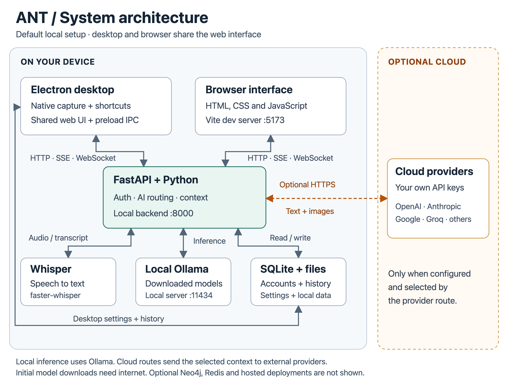

# ANT architecture diagram

[](overview.svg)

This diagram describes the default local setup in `v2.3.0-rc.1`. It shows connections, not a sequence of execution. Two arrowheads indicate requests and returned data; the dashed connection is the optional cloud AI route.

## How the pieces connect

1. **Desktop and browser:** the Electron renderer and browser use the interface in [`apps/web/`](../../apps/web/). Desktop native features go through [`electron/preload.js`](../../electron/preload.js) and [`electron/main.js`](../../electron/main.js); the browser does not have this IPC bridge.
2. **Backend:** Electron starts a loopback FastAPI server on port 8000. Source runs use `AINT_Venv`; packaged builds use their bundled Python. The browser development server runs separately on port 5173. See [`electron/lib/python-runtime.js`](../../electron/lib/python-runtime.js), [`backend/core/main.py`](../../backend/core/main.py), and [`apps/web/vite.config.js`](../../apps/web/vite.config.js).
3. **Voice:** microphone or supported system audio reaches the backend's WebSocket/upload transcription paths. [`whisper_handler.py`](../../backend/modules/voice/whisper_handler.py) transcribes locally with faster-whisper. The transcript can then become AI input.
4. **AI:** [`routes/ai.py`](../../backend/routes/ai.py) and [`ai_router.py`](../../backend/modules/ai/ai_router.py) route text and image context to a local Ollama server or configured cloud providers. Responses stream back to the interface. Auto/race mode can contact multiple enabled providers.
5. **Data:** the backend uses SQLite by default, with file storage for other data. Electron also writes conversation JSON and settings directly. Packaged backend data goes into a writable user-data directory. See [`database.py`](../../backend/core/database.py), [`storage_paths.py`](../../backend/lib/storage_paths.py), and [`conversation-storage.js`](../../electron/lib/conversation-storage.js).

This is not a complete deployment diagram. Neo4j, Redis, PostgreSQL, mobile clients, extensions and optional voice runtimes have separate configuration and are outside this overview. If the backend or Ollama endpoint runs on another machine, the corresponding processing and data are no longer local to the user's device.

## Edit and regenerate

[`overview.svg`](overview.svg) is the editable source. Its labels, paths and styles are plain SVG with no external fonts or images. The README embeds [`overview.png`](overview.png) for a consistent preview and links to the SVG for zooming.

After changing the SVG, run these commands from the repository root:

```bash
npm ci
npm --workspace ant-e2e-tests run install:browsers -- chromium
node docs/architecture/render.cjs
```

The renderer uses the existing Playwright dependency and exports a PNG at twice the SVG resolution. Review the result and commit both files together. No application build is needed.
