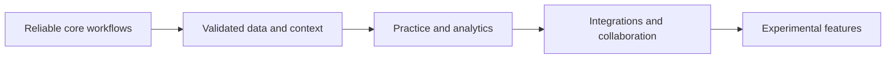

# Product roadmap and planning

This is the entry point for the master upgrade plan, Phase 2 plan, unique-feature roadmap, quarter plan, and sprint/start instructions. They describe proposed work at different times, not a single agreed delivery schedule.

## Dependency order

| Stage | Scope | Evidence needed before expanding |
| --- | --- | --- |
| Core | Setup, sign-in, transcription, AI routing, screen context, history, and recovery | Reproducible end-to-end checks |
| Data | User isolation, persistence, resume context, and optional graph memory | Migration, lifecycle, and context checks |
| Preparation | Practice questions, feedback, analytics, and study plans | Representative content and user-flow checks |
| Integration | Job tools, CRM, mobile, team access, and deployment | Working integrations on the supported environments |
| Research | Prediction, voice agents, autonomous tools, AR, and other experiments | A scoped prototype with quality and operational evidence |

## How to use the plans

1. Start from the current implementation and open issues.
2. Select a concrete user outcome and define how to validate it.
3. Resolve dependencies before assigning a milestone.
4. Estimate effort against the current codebase, not an April timeline.
5. Update this guide when scope is accepted; keep original plans in the historical record.

The original documents contain two-month, quarterly, 24-week, and multi-year schedules. None should be read as a current release commitment. Proposed autonomous, voice, XR, team, or monetization capabilities must be validated independently before being presented as available.

## Related topics

- [Competitive priorities](../competitive/README.md)
- [Resume tools](resume-builder/README.md)
- [Release readiness](../devops/deployment/RELEASE_CHECKLIST.md)
- [Historical model assignments](../research/model-comparisons-2026-04/README.md)

## Historical references

The overlapping source documents are preserved in one [dated reference record](../archive/product-roadmaps.md). Use that record for original technical examples and planning context, not current setup or status.
