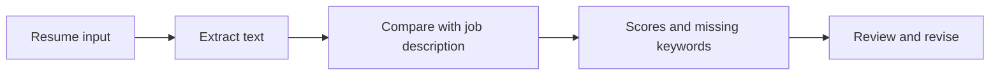

# Resume review and job context

ANT includes resume review tools and resume/job-description context for AI answers. This guide unifies the feature explanation, deployment notes, implementation reports, feature matrices, and product plans.

## Use the tools

1. [Set up ANT](../../../README.md#set-up-from-source) and sign in.
2. Open Resume Review from the app menu. Supply your resume and the target job description, then review the analysis.
3. For personalized conversation answers, open the **Resume and job description** control in the main window, use **Resume +**, and save the job description.
4. Review extracted content and recommendations. Edit or remove saved context when switching roles.
5. Use the [job workflow](../JOB_APPLICATION_WORKFLOW.md) to organize applications and interview preparation.

The main chat's resume context and the standalone resume-review pages are different flows. Attaching a resume to one should not be assumed to configure every tool.

## How analysis works

The original review engine describes section detection, keyword coverage, achievements, and formatting heuristics. V2 adds a broader analysis workflow. Scores and suggested keywords are guidance; they do not verify resume claims or predict an employer's decision. Extraction can lose tables and layout, and scanned PDFs may not provide usable text.

## Implementation map

| Area | Source |
| --- | --- |
| Original analysis | [resume_review.py](../../../backend/modules/interview/resume_review.py) |
| V2 analysis | [resume_review_v2.py](../../../backend/modules/interview/resume_review_v2.py) |
| Resume input handling | [resume_input.py](../../../backend/lib/resume_input.py) |
| Grounded conversation context | [resume_grounding.py](../../../backend/lib/resume_grounding.py) |
| Original review page | [resume-review.html](../../../apps/web/resume-review.html) |
| V2 review page | [resume-review-v2.html](../../../apps/web/resume-review-v2.html) |
| Career tailoring | [career.py](../../../backend/routes/career.py) |
| Extension workspace | [extension guide](../../../apps/ant-chrome-extension/README.md) |

Check the running [API documentation](http://127.0.0.1:8000/docs) for upload formats, request fields, authentication, and size limits. The older documents disagree about paths and supported formats, so they are preserved as historical examples rather than copied into new setup commands.

## Verify before release

Check extraction with representative resumes, analysis with and without a job description, authentication, user isolation, empty/invalid input, and that saved context reaches the intended conversation. Review generated text for unsupported claims.

## Plans and historical status

The April documents propose freemium pricing, benchmarking, video resumes, voice input, interview prediction, and application copilot features. They also claim broad launch completion. Those plans and claims are preserved in the reference record; they are not proof that billing or every proposed integration is live.

## Historical references

The overlapping source documents are preserved in one [dated reference record](../../archive/resume-tools.md). Use that record for original technical examples and planning context, not current setup or status.
